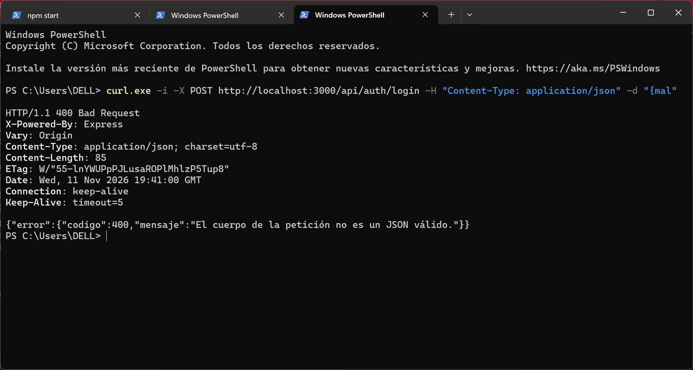

# Pruebas de fallo y robustez

Objetivo: provocar errores a propósito (datos malos, servicios apagados, permisos indebidos) para comprobar que OmniDesk los maneja con un mensaje claro y sin romperse ni exponer información.

- Fecha: 11 de noviembre del 2026
- Commit probado: ____ (`git log -1 --format=%h`)
- Carpeta usada: `C:\prueba-omnidesk` (copia de prueba, no la de uso diario)
- Navegador: ____

Cómo leer la tabla: **Debe pasar** es lo que se espera si todo está bien. Si no ocurre, anótalo en **Nota** (con captura) y cuenta como hallazgo, no como fracaso: para eso son las pruebas.

## A. Acceso y sesión

| # | Prueba | Cómo hacerla | Debe pasar | ¿Salió? | Nota |
|---|---|---|---|---|---|
| 1 | Contraseña incorrecta | En `login.html`, correo de prueba con contraseña mala | Mensaje de error en español; **no** dice si el correo existe | | |
| 2 | Bloqueo por intentos | Con `marcos.pena@omnidesk.local` (**no** con el admin), 5 contraseñas malas seguidas, luego la correcta | Al 6.º intento: "Cuenta bloqueada temporalmente por intentos fallidos. Intenta de nuevo en N minutos." Aun con la contraseña correcta | | |
| 3 | Entrar sin sesión | Abre `conversaciones.html` sin haber iniciado sesión (o borra `omnidesk_sesion` en F12 → Aplicación → Almacenamiento local) | Te manda al login; no queda en blanco | | |
| 4 | Sesión alterada | Con sesión iniciada, en el mismo lugar cambia **un carácter** del `token` y recarga | "Sesión inválida o expirada" y vuelve al login | | |
| 5 | Permiso indebido | Inicia como Agente (`marcos.pena`) y escribe a mano `reportes.html`, `roles.html`, `auditoria.html` | No muestra datos (mensaje "No tienes permiso…" o te saca) | | |
| 6 | Cerrar sesión y retroceder | Cierra sesión y pulsa "Atrás" del navegador | No muestra conversaciones; pide iniciar sesión | | |

## B. Datos mal escritos (widget y formularios)

| # | Prueba | Cómo hacerla | Debe pasar | ¿Salió? | Nota |
|---|---|---|---|---|---|
| 7 | Campos vacíos o inválidos | En `widget.html`: nombre vacío; mensaje vacío; correo `abc` | Avisos: "Escribe tu nombre…", "Escribe tu mensaje…", "El correo no es válido." No se crea conversación | | |
| 8 | Mensaje demasiado largo | Pega 1001 caracteres en el widget | "Escribe tu mensaje (hasta 1000 caracteres)." | | |
| 9 | Código en el mensaje (XSS) | Envía `` y luego `` | Se ve como **texto** en el widget y en el panel; **no** sale ninguna ventana de alerta | | |
| 10 | Comillas y SQL | Nombre: `Robert'); DROP TABLE conversaciones;--` | Se guarda como texto; el sistema sigue funcionando | | |
| 11 | Texto largo sin espacios | Envía 900 letras `a` juntas | El chat no se ensancha ni rompe el diseño | | |
| 12 | Foto falsa | En Mi perfil, sube un `.txt` renombrado a `.png` | Error claro; la foto no cambia | | |

## C. Abuso y límites

| # | Prueba | Cómo hacerla | Debe pasar | ¿Salió? | Nota |
|---|---|---|---|---|---|
| 13 | Spam en el widget | Envía 6 mensajes seguidos en menos de un minuto | El 6.º: "Demasiadas peticiones seguidas. Espera un minuto." | | |
| 14 | Token del widget inventado | Abre `http://localhost:3000/api/widget/mensajes?token=abc` y luego con 48 letras `a` | Responde 404 ("no encontrado") en ambos casos | | |
| 15 | IA muchas veces | Pulsa "Analizar con IA" 10 veces seguidas | En algún momento: "Has pedido demasiados análisis seguidos. Espera un minuto." | | |

## D. Archivos y secretos

| # | Prueba | Cómo hacerla | Debe pasar | ¿Salió? | Nota |
|---|---|---|---|---|---|
| 16 | `.env` no se sirve | Abre `http://localhost:3000/.env` | "Cannot GET /.env" (404), nunca el contenido | | |
| 17 | Sin listado de fotos | Abre `http://localhost:3000/uploads/avatares/` | 404; no muestra la lista de archivos | | |
| 18 | Sin claves en el código visible | En una página, clic derecho → Ver código fuente → Ctrl+F `AIza` y `JWT` | Sin resultados | | |

## E. Servicios que fallan

| # | Prueba | Cómo hacerla | Debe pasar | ¿Salió? | Nota |
|---|---|---|---|---|---|
| 19 | Python apagado | Ctrl+C en la terminal de `uvicorn`; pulsa "Analizar con IA" | Responde con el respaldo de Node o con un mensaje claro; no se queda cargando para siempre | | |
| 20 | Sin internet | Apaga el Wi-Fi; pulsa "Analizar con IA" | "No se pudo conectar con la IA. Revisa la conexión a internet…" | | |
| 21 | Clave de IA inválida | En el `.env` de la **copia de prueba**, pon `GEMINI_API_KEY=xxxx`; reinicia backend y Python; Analizar | Mensaje de error comprensible, sin texto técnico. **Restaura la clave real después** | | |
| 22 | Backend apagado | Con el panel abierto, Ctrl+C al backend; recarga la página | Mensaje "No se pudo conectar…"; no pantalla en blanco. Al encender de nuevo y recargar, funciona | | |
| 23 | MySQL apagado (opcional) | En XAMPP pulsa **Stop** en MySQL; abre el panel; luego **Start** | Mensaje de error amable; el backend no se cierra; al volver MySQL, funciona | | |

## Hallazgos

| # | Qué se vio | Gravedad | Corrección |
|---|---|---|---|
| Extra | Un JSON mal formado enviado al servidor respondía 500 "Error interno del servidor". | Menor | Corregido en `backend/src/server.js` (commit f7a6f68): ahora responde 400 con "El cuerpo de la petición no es un JSON válido." (y 413 si es demasiado grande). |
| Extra | `/api/salud` muestra el código técnico del error cuando MySQL falla. | Menor | Sin cambio (decisión: útil para diagnosticar en un proyecto académico). |
| Extra | Una sesión sigue válida hasta 8 h aunque desactiven al usuario después de iniciar sesión. | Menor | Sin cambio; queda como mejora futura. |

(Añade aquí lo que encuentres en tus pruebas: número, qué viste y captura.)

## Capturas

- Prueba de JSON roto (400 en vez de 500): 
