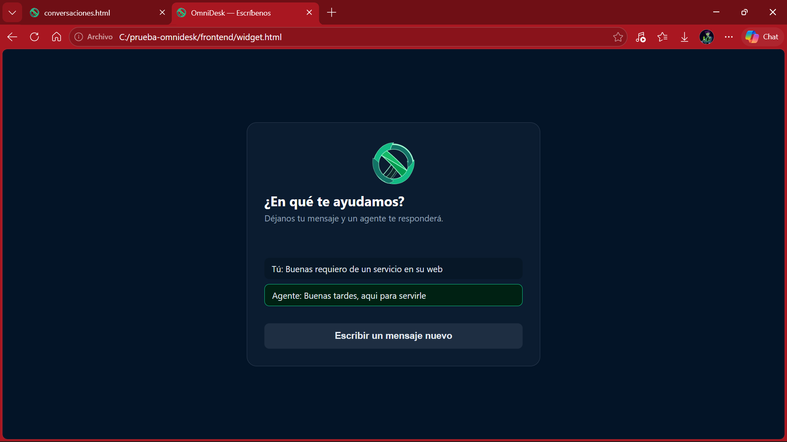
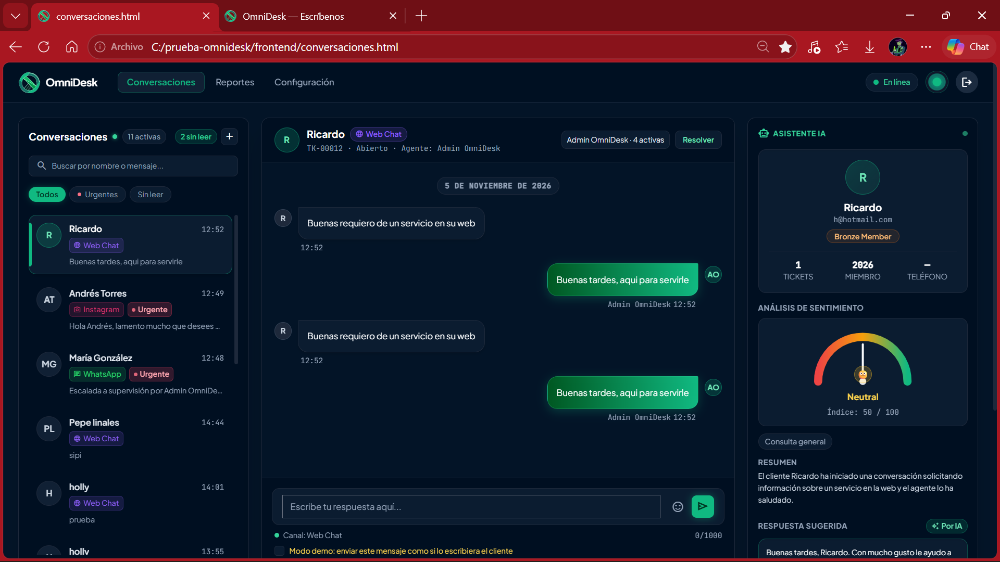

# Evidencia de instalación limpia

Prueba de que el proyecto se levanta desde cero siguiendo solo el README.

- Fecha: 03-nov-2026 · commit 5abc673
- Carpeta usada: `C:\prueba-omnidesk` (clon nuevo del repositorio, sin `.env` ni `node_modules` de la carpeta de trabajo)
- Base de datos usada: MariaDB 10.4.32 de XAMPP, base `omnidesk_db` (recreada con los dos SQL del README)

| # | Paso | Resultado esperado | ¿Salió? | Nota |
|---|---|---|---|---|
| 1 | `git clone` del repositorio | Carpeta con `backend`, `frontend`, `db`, `docs`, `ia-python` | Sí | Clon en `C:\prueba-omnidesk`; después `git pull` trajo los 4 commits del widget |
| 2 | Importar `db/base-de-datos.sql` y luego `db/datos-demo.sql` | Base creada con datos | Sí | Importado desde phpMyAdmin; `usuarios` quedó con 4 filas |
| 3 | `cd backend`, copiar `.env.example` a `.env`, poner `JWT_SECRET` | Archivo `.env` creado | Sí | Sin `DB_NAME`: usa `omnidesk_db` por defecto |
| 4 | `npm install` | Sin errores | Sí | |
| 5 | `npm run admin` | Contraseña asignada al usuario de prueba | Sí | admin@omnidesk.local |
| 6 | `npm start` | "OmniDesk API lista en http://localhost:3000" | Sí | |
| 7 | Abrir `http://localhost:3000/api/salud` | `base_de_datos: conectada` | Sí | |
| 8 | Servicio Python: `pip install -r requirements.txt` y `python -m uvicorn main:app --port 8000` | `http://localhost:8000/salud` responde | Sí | Primero `activa: false`: faltaba `GEMINI_API_KEY` en `backend/.env`. Al ponerla y reiniciar el servicio: `activa: true, proveedor gemini, modelo gemini-3.5-flash-lite` |
| 9 | Iniciar sesión en el frontend | Entra al panel | Sí | Con `IA_SERVICIO_URL=http://localhost:8000` en el `.env` |
| 10 | Analizar con IA la conversación de María González | Aparece puntaje, resumen y respuesta sugerida | Sí | |
| 11 | Abrir `frontend/widget.html`, enviar un mensaje | "Recibimos tu mensaje" y aparece una conversación nueva en el panel | Sí | Llegó como Web Chat sin asignar; la respuesta del agente apareció en el widget en menos de 10 s |

## Lo que se aprendió

- El servicio de Python lee las claves de `backend/.env` solo al arrancar: si se agrega `GEMINI_API_KEY` después, hay que reiniciarlo.
- Para abrir las páginas con doble clic (sin Apache ni servidor), `CORS_ORIGIN` debe incluir `null`; con Apache o `python -m http.server 5500` basta el origen normal.

## Capturas
- Segunda corrida (09-nov-2026): widget mostrando la respuesta del agente, abierto desde `C:/prueba-omnidesk/frontend/widget.html`.

